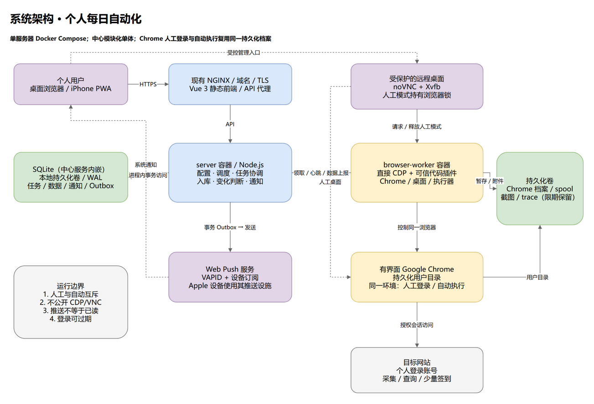
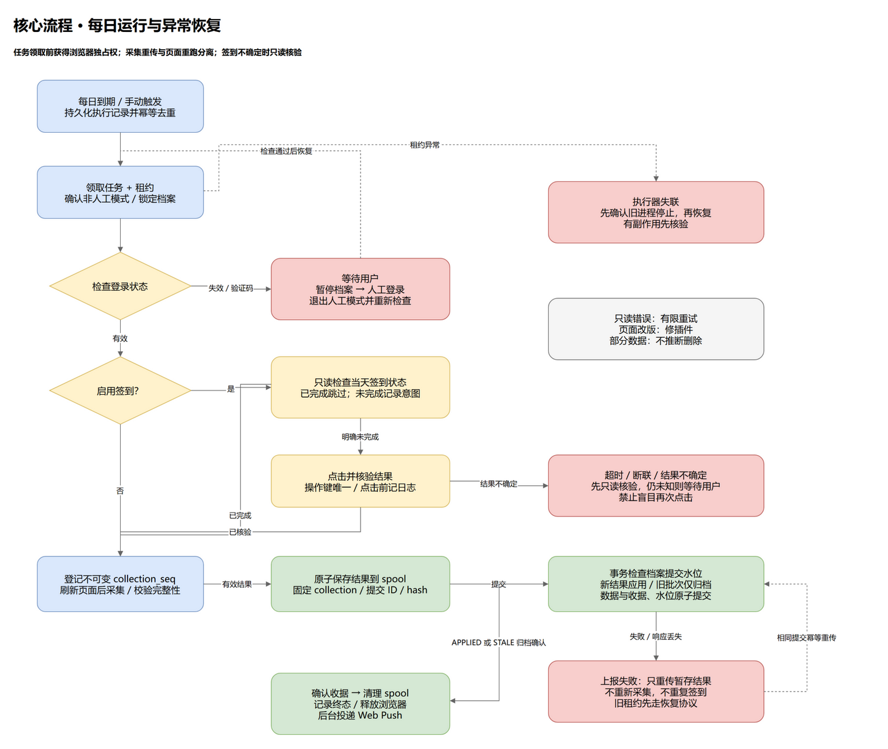
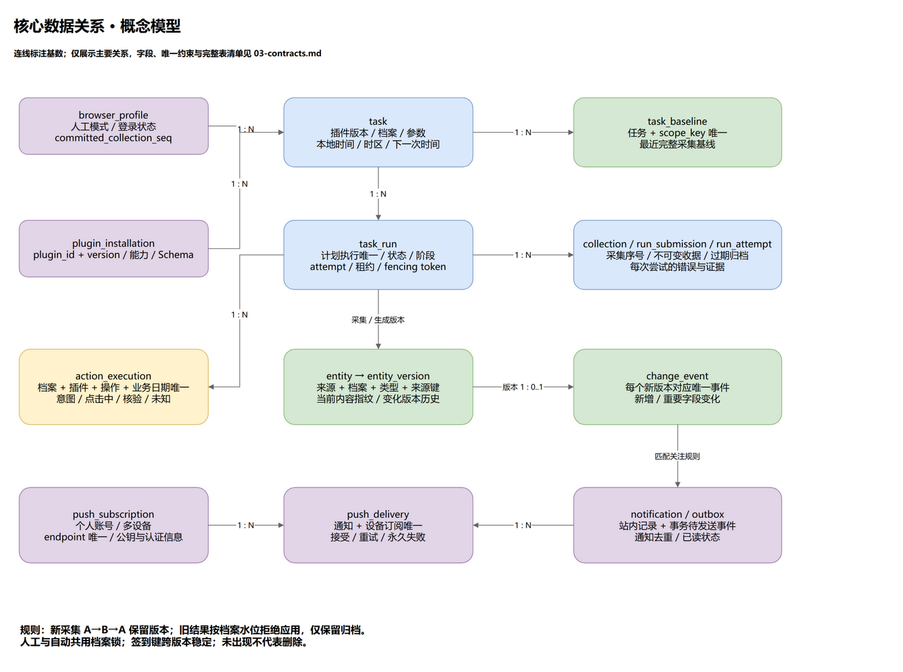

# 图形设计

全部图形以原生 `.drawio` 为编辑源，同时提供包含嵌入图形 XML 的 PNG 预览。保留编辑源，便于后续架构讨论修改。

| 图 | 编辑源 | 预览 |
|---|---|---|
| 系统架构 | [system-architecture.drawio](system-architecture.drawio) | [PNG](system-architecture.drawio.png) |
| 每日执行与异常恢复 | [execution-flow.drawio](execution-flow.drawio) | [PNG](execution-flow.drawio.png) |
| 核心数据关系 | [data-model.drawio](data-model.drawio) | [PNG](data-model.drawio.png) |

## 阅读说明

蓝色表示平台服务与任务，黄色表示浏览器或操作判断，绿色表示数据与持久化，紫色表示人工入口和通知，红色表示异常处理。实线表示主要调用或数据关系，虚线表示人工访问、系统通知或恢复分支；以每条连线文字为准。

架构图是逻辑视图：中心服务与浏览器执行器各自运行在独立容器；Chrome、Xvfb、noVNC、插件和执行器属于同一浏览器容器，持久化卷属于宿主机存储。Web/PWA 使用 Vue 3（推荐方案）静态构建产物，由现有 NGINX 提供并代理 server API；域名和 HTTPS 复用现有设施。server 为独立 Node.js 容器，浏览器执行器、Chrome 与桌面共处 browser-worker 容器；图中的 Chrome 和远程桌面节点是该容器的内部组成，并非额外容器。SQLite 节点表示中心进程内嵌数据库及其本地持久化文件，不是独立服务或数据库容器；仅中心服务访问，执行器通过 API 上报。Web Push 是外部服务，目标网站也是外部系统。

流程图展示正常路径和主要恢复路径，并非穷尽状态机。数据图将相关表合并成节点以便阅读，实际关系和字段以 [插件、数据与接口设计](../03-contracts.md) 为准。

## 打开与维护

使用 draw.io Desktop 或 diagrams.net 打开 `.drawio` 即可修改。PNG 可直接阅读，也可以在 draw.io 中打开以恢复嵌入图形。

`generate-diagrams.py` 使用 Python 标准库生成这些原生图形并校验 ID、端点与边 geometry；运行会覆盖 `.drawio`，因此手动修改后不要直接重新生成，除非已同步脚本。

```bash
python docs/diagrams/generate-diagrams.py
```

本次已使用本机 draw.io Desktop 成功导出三张 PNG 并检查渲染。后续导出可使用以下形式，Windows 下将 draw.io 替换为安装目录内的可执行文件路径：

```bash
drawio --disable-gpu -x -f png -e -b 20 -o system-architecture.drawio.png system-architecture.drawio
```

示例命令在图形目录内运行。设计源为 XML，已通过实际 draw.io 导出验证兼容性。

## 系统架构预览



## 核心流程预览



## 核心数据关系预览


